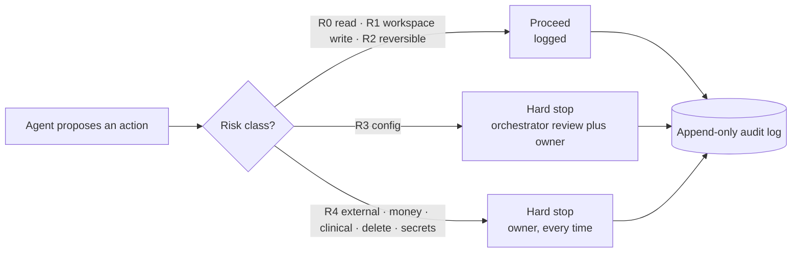

# Agent governance kit

**A practical governance framework for AI agents that touch real work: autonomy levels, risk classes, human approval tiers, kill switches, an audit spine and a promotion gate, mapped to OWASP, NIST and ISO/IEC 42001, with a healthcare overlay for India.**

This kit is the public, generic form of the governance framework the author designed for his own multi-agent platform, where it binds every agent. It is written by a clinician with 20 years of hospital operations, so it borrows from clinical practice: nothing touches the patient without a check, and anything that can't be undone needs a named human.

The rules in the table below come from that framework. The guidance around them, the templates and the checker are written to be generic, so you can adopt them in your own system.

[](https://scorecard.dev/viewer/?uri=github.com/sterilefield/agent-governance-kit)

## The framework on one page



| Element | Rule |
|---|---|
| [Autonomy levels](docs/autonomy-levels.md) | L0 Observer → L1 Proposer → L2 Operator → L3 Delegate → L4 Autonomous (**deliberately unused**). Health, money, external sends, deletions and secrets never sit above L3. |
| [Risk classes](docs/risk-classes.md) | R0 read → R1 workspace write → R2 reversible operations → R3 configuration → R4 external sends, money, clinical, deletion or secrets |
| [Human-in-the-loop tiers](docs/controls.md#human-in-the-loop-tiers) | Hard stop for spend, external messages, irreversible actions and security · soft stop with a 3-minute window · silent proceed for routine work |
| [Kill switches](docs/controls.md#kill-switches) | Stop one agent or all agents; stop and restore from a dashboard; quarantine, never delete |
| [Audit spine](docs/controls.md#audit-spine) | Append-only JSONL with OpenTelemetry GenAI fields, kept at least a year, encrypted off-site |
| [Promotion gate](docs/promotion-gate.md) | ≥ 30 days and ≥ 20 actions with 0 critical incidents, an eval suite with prompt-injection tests, and an owner decision. Any R3/R4 incident demotes automatically. |
| [Access](docs/controls.md#access) | Deny by default, role-based |
| [Exec gate](docs/controls.md#exec-gate) | Pre-approved commands run silently; destructive commands need a written approval card |
| [Prompt-injection defence](docs/controls.md#prompt-injection-defence) | Canary patterns stop the agent; agent output is data, never instructions |
| [Change control](docs/controls.md#change-control) | Every config change is a changeset with a reason, a review and automatic rollback |

## Standards mapping

[docs/standards-mapping.md](docs/standards-mapping.md) maps each control to the **OWASP Top 10 for Agentic Applications 2026** (ASI01–ASI10), the **OWASP Top 10 for LLM Applications 2025**, the **NIST AI RMF** functions, **ISO/IEC 42001** clauses, MCP consent practice and India's **DPDP Rules 2025**.

## Healthcare overlay (India)

[docs/healthcare-overlay.md](docs/healthcare-overlay.md) adds the rules a clinic or hospital needs on top: the Telemedicine Practice Guidelines 2020, the DCI Code of Ethics 2014, WhatsApp Business messaging rules and DPDP consent.

## Templates you can copy

| Template | Use it for |
|---|---|
| [templates/agent-policy.yaml](templates/agent-policy.yaml) | One agent's level, allowed risk classes, budgets and tools |
| [templates/approval-card.md](templates/approval-card.md) | Asking a human to approve an R3/R4 action |
| [templates/audit-event.schema.json](templates/audit-event.schema.json) | One line of the audit log, with OTel GenAI fields |
| [templates/promotion-review.md](templates/promotion-review.md) | Deciding whether an agent moves up a level |
| [templates/incident-rca.md](templates/incident-rca.md) | Writing up an incident and the guard added after it |
| [templates/injection-response.md](templates/injection-response.md) | A starting runbook for a suspected prompt injection |

## Check your policies in code

`kit/govcheck.py` is a small checker (Python, PyYAML only). It validates agent policies against the framework (for example, no agent above L3 may hold R4 rights, and L4 is refused) and checks audit events for required fields.

```bash
python3 kit/govcheck.py policy templates/agent-policy.yaml
python3 kit/govcheck.py audit examples/audit-sample.jsonl
```

Run the tests with `pip install -r requirements.txt && python3 -m pytest -q`, or every gate (secret scan, link check, tests) with `bash scripts/check.sh`.

## Related

- [empire-os-reference-architecture](https://github.com/sterilefield/empire-os-reference-architecture): the platform this framework governs.
- [llm-token-economics](https://github.com/sterilefield/llm-token-economics): budgets and caps, the cost side of governance.

## Author

**Dr. Ravi Teja Thiriveedhi**: clinician turned AI systems architect, with 20 years of clinical practice and hospital operations. [GitHub](https://github.com/Raviteja2k2k) · [LinkedIn](https://www.linkedin.com/in/dr-ravi-teja-thiriveedhi)

## Licence

[Apache-2.0](LICENSE). Use, adapt and ship it, with attribution. This kit is engineering guidance, not legal advice; check regulations with a qualified adviser before relying on them.
