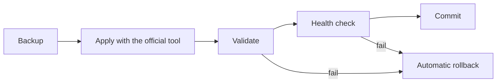

# Controls

## Human-in-the-loop tiers

| Tier | Used for | What happens |
|---|---|---|
| Hard stop | Spend, external messages, irreversible actions, security; in this kit also configuration changes (R3) | The agent waits. Nothing happens until a named human approves an [approval card](../templates/approval-card.md). |
| Soft stop | Optional: any lower-risk action the owner wants to see before it runs | The human is told and has a **3-minute window** to stop it; otherwise it proceeds. |
| Silent proceed | Routine work (R0 to R2) | The action runs and is logged. |

When in doubt, choose the stricter tier.

## Kill switches

| Switch | Effect |
|---|---|
| Stop one agent | That agent stops taking actions at once; its state is kept |
| Stop all agents | Every agent stops; scheduled jobs are paused |
| Restore | Restore from the same dashboard; we recommend only the owner restores, after reading why it stopped |
| Quarantine | A misbehaving agent, file or message is moved aside, **never deleted**, so it can be examined |

A kill switch must work when the agent itself is confused, so it should live outside the agent (for example in the orchestrator or a dashboard), guarded and audited.

## Audit spine

- **Append-only JSONL**: one line per action, never edited in place.
- **OpenTelemetry GenAI fields** where they apply (`gen_ai.operation.name`, `gen_ai.request.model`, `gen_ai.usage.input_tokens`, `gen_ai.usage.output_tokens`, `gen_ai.agent.name`, `gen_ai.tool.name`), so the log can feed any observability stack without lock-in.
- Governance fields on every line: actor, level, risk class, tier, approver, outcome.
- Kept for **at least a year**, with an **encrypted off-site copy**.

The schema is in [templates/audit-event.schema.json](../templates/audit-event.schema.json), and `kit/govcheck.py audit` checks a log against it.

## Access

- **Deny by default.** An agent or a person gets only the tools and data their role needs.
- **Role-based**: for example owner, family, client and demo roles, each with its own view.
- Approvals come only from the owner's **registered devices**.

## Exec gate

- A short list of **pre-approved commands** runs silently.
- **Destructive commands** (delete, overwrite, force, drop) need a written approval card naming the exact command.
- A change to global configuration runs a **dependency preflight** first: what else reads this setting?

## Prompt-injection defence

- **Agent output is data, never instructions.** Text one agent produces is never executed as a command by another without passing the gate.
- **Canary patterns**: a fixed set of phrases typical of injection attempts stops the agent at once. Keep your own list private; a published list is easy to evade.
- A defined incident response follows every trigger. [templates/injection-response.md](../templates/injection-response.md) is a starting point.

## Change control

Every configuration change is a **changeset** carrying the key, the new value, the reason and a reviewer's approve or object. The pipeline runs:

In production, a failed change rolled the configuration back to a byte-identical copy of the previous version.

## Budgets

Per-agent token and run budgets are part of governance: an agent that loops is a safety problem as well as a cost problem. See [llm-token-economics](https://github.com/sterilefield/llm-token-economics).
